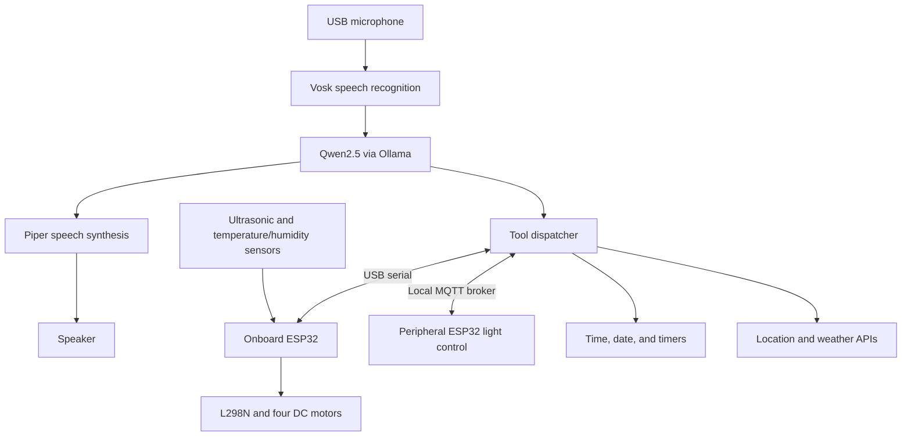

# Home-E
A Mobile and Scalable AI-Enhanced Home Assistant
Home-E is a mobile robotic assistant that combines local speech recognition, language-model reasoning, and speech synthesis with physical movement and environmental sensing. Built around a Raspberry Pi 4 and an ESP32, it translates spoken requests into actions through a structured tool interface.

The core voice interaction pipeline runs entirely on the Raspberry Pi. Outdoor weather queries use external APIs, while wireless peripheral control uses a local network.

Project repository
Features
- Local voice interaction: Vosk transcribes speech, Qwen2.5 interprets requests, and Piper generates spoken responses.
- Natural-language tool calling: JSON-defined tools map varied command phrasing to supported robot actions and information queries.
- Mobile platform: A four-wheel drivetrain supports manual control and autonomous obstacle avoidance.
- Environmental sensing: Onboard sensors measure obstacle distance, temperature, and humidity.
- Wireless peripheral control: An auxiliary ESP32 controls a light switch through MQTT.
- Modular construction: A custom 3D-printed chassis and removable electronics enclosures support maintenance and expansion.
System Architecture
The Raspberry Pi handles speech processing, reasoning, tool execution, and the local MQTT broker. The onboard ESP32 handles motor control and sensor readings, communicating with the Pi over a USB serial connection at 115200 baud.

Voice and Tool Pipeline
1. Wake-word detection: A dedicated Vosk recognizer listens for phrases such as “Hey Homey.” A constrained grammar prioritizes valid wake phrases and includes an unknown-word category.
2. Speech recognition: Captured microphone audio is resampled from 44.1 kHz to the 16 kHz input used by the speech recognizer.
3. Language reasoning: qwen2.5:1.5b, served locally through Ollama, interprets the transcript against a JSON tool schema.
4. Execution: The selected tool performs a robot action, reads a sensor, controls a peripheral, or retrieves information. Requests that do not match a tool can receive conversational responses.
5. Speech synthesis: Piper uses en_US-lessac-medium.onnx to turn response text into spoken audio.
Supported requests include movement, operating-mode changes, room temperature and humidity, light control, time, date, timers, and outdoor weather. Weather queries use ip-api.com for approximate location and Open-Meteo for weather data.
Hardware
Component	Role
Raspberry Pi 4 Model B	Local AI pipeline, tool execution, and MQTT broker
ESP-WROOM-32 development board	Motor control and onboard sensor interface
L298N motor driver	Motor direction and PWM speed control
Four 12 V DC motors	Four-wheel drivetrain described in the paper
HC-SR04 ultrasonic sensor	Distance measurement for obstacle avoidance
DHT22 sensor	Temperature and humidity measurement
USB microphone and speaker	Voice input and spoken responses
Auxiliary ESP32	Wireless light-switch control
Portable power bank and separate 12 V battery pack	Raspberry Pi and motor power, respectively
Custom 3D-printed chassis and enclosures	Mechanical structure and electronics mounting

The chassis and enclosures were designed in Fusion 360. Removable panels provide access to internal wiring, and separate enclosures house the Raspberry Pi and motor-control electronics.

The HC-SR04 echo signal passes through a voltage divider to reduce its 5 V output to the ESP32's 3.3 V logic level. The onboard ESP32 receives power through its USB connection to the Raspberry Pi; the motor driver uses a separate battery supply.
Navigation and Serial Control
Home-E uses a finite-state machine with two operating modes:
- Manual: Executes user-issued movement commands.
- Autonomous: Moves forward while monitoring distance. When an obstacle is detected within 20 cm, the robot stops, turns randomly left or right, and resumes forward motion.
The Raspberry Pi sends single-byte ASCII commands to the onboard ESP32:
Byte	Action
W	Drive forward
A	Turn left
S	Drive backward
D	Turn right
M	Stop motors and enter manual mode
T	Enter autonomous mode
V	Stop motors and return to manual mode
R	Return temperature and humidity readings

Movement commands are accepted only in manual mode. Mode changes and the stop command can be processed in either mode.
Experimental Results
The paper evaluates 200 command trials, including 15 cold-start and 185 warm-start trials, and 40 wake-word trials. Cold-start measurements capture the first command after boot; warm-start measurements capture subsequent commands.
Response Latency
Pipeline stage	Cold-start mean	Warm-start mean
Speech-to-text	5.21 s	4.82 s
LLM reasoning	128.68 s	12.81 s
Text-to-speech	9.23 s	11.45 s
Total	143.12 s	29.09 s

The median total warm-start latency was 24.08 s. A separate diagnostic attributed approximately 95% of the cold-start LLM-stage latency to prompt evaluation. Longer conversational responses also increased reasoning and speech-synthesis time.
Command Accuracy
Command category	Correct / total	Accuracy
Hardware	77 / 95	81.1%
Wireless hardware	19 / 19	100.0%
Network	8 / 14	57.1%
Raspberry Pi local	41 / 50	82.0%
Conversational fallback	11 / 12	91.7%
Compound commands	8 / 10	80.0%
Overall	164 / 200	82.0%

These results measure the complete command pipeline, including speech transcription. Of the 36 unsuccessful trials, 30 involved transcription failures and six involved reasoning errors. Audio capture and speech recognition were therefore the primary sources of observed command failures.
Wake-Word Recognition
Constraining the wake-word recognizer's grammar reduced the average number of activation attempts from 4.70 to 1.10, measured over 20 trials before and 20 trials after the change. The paper reports a Welch's t-test result of p ≈ 2.0 × 10⁻⁸.
Current Limitations
- Response time: CPU-based inference creates substantial cold-start delays. Pre-warming helped only when initialization finished before the user's request.
- Audio interference: Motor and background noise can impair transcription. Spoken stop commands achieved only 20% accuracy in the reported tests and should not be treated as a dependable emergency stop.
- Indirect phrasing: Indirect command variations achieved 20% accuracy in separate testing.
- Network-dependent tools: Outdoor weather retrieval requires connectivity and external services.
- Navigation scope: Autonomous movement uses reactive ultrasonic obstacle avoidance; mapping, localization, and person following were not demonstrated in the reported evaluation.
Future Work
Proposed improvements include better microphone placement and noise handling, more reliable model initialization, refined tool descriptions and prompts, and more capable onboard compute for faster inference or larger models.

The modular architecture could also support additional sensors, actuators, and MQTT peripherals. Home monitoring, care assistance, and baby or pet supervision are proposed applications that would require further development and validation.
Research Paper
This README summarizes “Home-E: A Mobile and Scalable AI-Enhanced Home Assistant.” Hardware specifications and experimental results reflect the supplied manuscript. The paper covers the mechanical design, electronics, communication protocols, local AI pipeline, and experimental evaluation.
